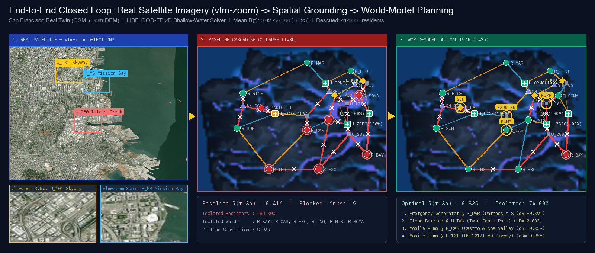
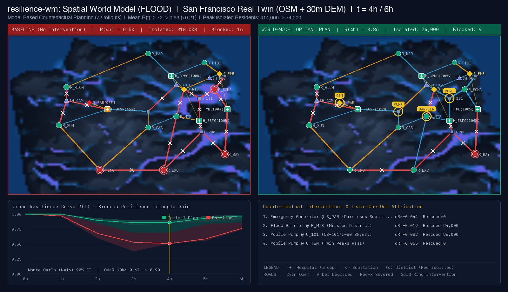
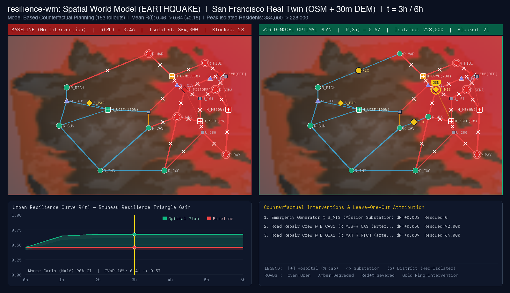
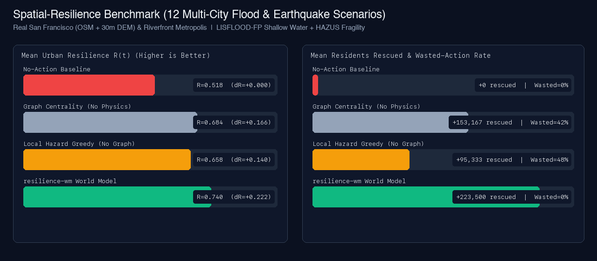

# resilience-wm

**Neuro-Symbolic Spatial World Model for Urban Resilience (`v0.2.0`)** — coupling real-world city terrain & OSM infrastructure, mass-conserving **LISFLOOD-FP 2D shallow-water physics**, **HAZUS 4-state seismic fragility + Monte Carlo 90% CI / CVaR-10%**, counterfactual intervention planning, **Gymnasium RL (`verl` GRPO-ready)**, a **zero-dependency MCP Server**, and **real satellite imagery + `vlm-zoom` grounding** in pure Python on CPU.

<p align="center">
  <a href="README_CN.md">中文文档</a> &bull;
  <a href="#end-to-end-real-satellite--world-model-closed-loop">Real Satellite Loop</a> &bull;
  <a href="#real-san-francisco-digital-twin-osm--aws-30m-dem">Real San Francisco Twin</a> &bull;
  <a href="#spatial-resilience-benchmark">Benchmark</a> &bull;
  <a href="#mcp-server--rl-environment">MCP &amp; RL</a> &bull;
  <a href="#quick-start">Quick Start</a>
</p>

<p align="center">
  
  
  
  
  
</p>

---

## End-to-End Real Satellite + World-Model Closed Loop

> **Real San Francisco Eastern Bayfront Satellite Orthophoto** (`vlm-zoom` 3.5x multi-region inspection of US-101 Skyway, Mission Bay & Islais Creek) &rarr; **Spatial Grounding onto Real San Francisco OSM + AWS 30m DEM** &rarr; **LISFLOOD-FP 2D Shallow-Water Rollout & Counterfactual Optimal Plan** (**414,000 residents rescued**).

<p align="center">
   World-Model Closed Loop" width="100%" />
</p>

---

## Core Capabilities (`v0.2.0`)

1. **Real-World City Data Pipeline (`OSM + AWS 30m Terrarium DEM`)**:
   - Bundled **San Francisco Real Digital Twin** (`build_real_sf_city()`): real 30m AWS Mapzen Terrarium elevation DEM (`0m` Pacific/Bay coastline up to `255m` Twin Peaks / Mt Davidson), verified OSM/PG&E/DPH infrastructure (`Zuckerberg SF General`, `UCSF Mission Bay`, `CPMC Van Ness`, `UCSF Parnassus`, `Embarcadero` & `Mission` substations, US-101 Skyway, I-280 Islais Creek), and 820,000 census residents.
   - Live **`resilience-wm fetch-city --bbox south,west,north,east`** downloads real 30m DEM + OSM hospitals/substations for **any city on Earth**.
2. **Physics-Grade Solvers + Stochastic Uncertainty Quantification**:
   - **LISFLOOD-FP Local Inertial 2D Shallow-Water Equations** (Bates et al., 2010) with spatially distributed Manning roughness $n(r,c)$, CFL sub-stepping, Green-Ampt pervious infiltration, and verified machine-precision mass conservation (`rel_err = 7.95e-8`).
   - **HAZUS 4-State Lognormal Seismic Fragility** (`Slight / Moderate / Extensive / Complete`) + continuous Vs30 alluvium/bedrock site amplification.
   - **Monte Carlo Uncertainty Quantification (`evaluate_monte_carlo`)**: plots **90% confidence interval bands `[P05, P95]`** and computes **CVaR-10%** tail risk.
3. **12-Scenario Spatial-Resilience Benchmark (`resilience-wm benchmark`)**:
   - Quantitative comparison across Real San Francisco & Riverfront Metropolis (Flood + Earthquake), contrasting `No-Action`, `Graph Centrality`, `Local Hazard Greedy`, optional `Zero-Shot LLM (--llm-url)`, and `resilience-wm World Model` on resilience gain $\Delta R$, residents rescued, and **wasted/hallucinated action rate**.
4. **Standard Agent & RL Ecosystem Interfaces**:
   - **Zero-dependency JSON-RPC 2.0 MCP Server (`resilience-wm mcp`)**: plug directly into Claude Code, Cursor, or Antigravity (`list_cities`, `inspect_city_graph`, `simulate_disaster`, `optimize_response_plan`).
   - **Gymnasium-compatible RL Environment (`ResilienceEnv`)** + drop-in **`verl` GRPO/RLOO reward verifier** ([verl_grpo_reward_hook.py](examples/verl_grpo_reward_hook.py)) with explicit invalid/duplicate hallucination penalties.

---

## Real San Francisco Digital Twin (OSM + AWS 30m DEM)

### Extreme Cloudburst Flood (`340 mm / 6h`, LISFLOOD-FP + Monte Carlo N=16)

- **Mean Resilience $R(t)$**: `0.72 -> 0.93` (**`+0.21`**) | **CVaR-10%**: `0.67 -> 0.90`
- **Peak Isolated Residents**: `414,000 -> 74,000` (**340,000 SF residents rescued**)

<p align="center">
  
</p>

### Near-Field Bayfront Earthquake (`Mw 6.8`, HAZUS 4-State + Monte Carlo N=16)

- **Mean Resilience $R(t)$**: `0.457 -> 0.637` (**`+0.180`**) | **CVaR-10%**: `0.406 -> 0.575`
- **Peak Isolated Residents**: `384,000 -> 228,000` (**156,000 SF residents rescued**)

<p align="center">
  
</p>

---

## Spatial-Resilience Benchmark

Evaluated deterministically across **12 diverse multi-city scenarios** (Real San Francisco + Riverfront Metropolis &times; Flood & Earthquake &times; varied storm tracks & epicenters):

| Strategy | Mean Resilience `R(t)` | Mean Gain `ΔR` | Mean Residents Rescued | Wasted / Hallucinated Action Rate | Avg Latency |
| --- | :---: | :---: | :---: | :---: | :---: |
| `no_action` (Baseline) | `0.518` | `+0.000` | `0` | `0.0%` | `21 ms` |
| `hazard_greedy` (Local Depth/PGA, No Graph) | `0.658` | `+0.140` | `95,333` | **`48.0%`** | `21 ms` |
| `graph_centrality` (Pure Topology, No Physics) | `0.684` | `+0.166` | `153,167` | **`42.0%`** | `21 ms` |
| **`world_model_planner` (`resilience-wm`)** | **`0.740`** | **`+0.222`** | **`223,500` (+134% vs greedy)** | **`0.0%`** | `1.1 s` |

<p align="center">
  
</p>

Run with your own LLM endpoint to measure Zero-Shot LLM spatial hallucination directly:

```bash
resilience-wm benchmark --llm-url http://localhost:8000/v1 --model Qwen/Qwen3-VL-4B-Instruct --out-png bench.png
```

---

## Animated World-Model Rollout (Riverfront Metropolis `0h -> 6h`)

<p align="center">
  
</p>

---

## MCP Server & RL Environment

### 1. Mount as a Zero-Dependency MCP Server (`Claude Code` / `Cursor` / `Antigravity`)

```json
{
  "mcpServers": {
    "resilience-wm": {
      "command": "resilience-wm",
      "args": ["mcp"]
    }
  }
}
```

Exposes 4 structured JSON tools: `list_cities`, `inspect_city_graph`, `simulate_disaster`, and `optimize_response_plan`.

### 2. Train Sequential Dispatch Policies with `ResilienceEnv` & `verl` GRPO

```python
from resilience_wm import ResilienceEnv

env = ResilienceEnv(city="sf", hazard="earthquake", randomize=True)
obs, info = env.reset(seed=42)
obs, reward, terminated, truncated, info = env.step(("mobile_generator", "S_MIS"))
print(info["state_text"], f"reward={reward:+.4f}")
```

See [examples/verl_grpo_reward_hook.py](examples/verl_grpo_reward_hook.py) for a drop-in `verl` GRPO/RLOO verifiable physics reward hook (`compute_score`).

---

## Quick Start

```bash
git clone https://github.com/ca33-zx/resilience-wm.git
cd resilience-wm
pip install -e ".[dev]"

# Generate all Real SF & Riverfront PNGs (with Monte Carlo 90% CI), GIF, Benchmark & HTML sandboxes
resilience-wm demo --out-dir assets --mc-samples 16

# Run planning on Real San Francisco with Monte Carlo uncertainty quantification
resilience-wm plan --city sf --hazard flood --mc-samples 20 --out-html sf_flood.html

# Fetch ANY real city on Earth from OpenStreetMap + AWS 30m Terrarium DEM
resilience-wm fetch-city --bbox 37.72,-122.46,37.80,-122.38 --name "San Francisco Core" --hazard earthquake

# Open the zero-CDN interactive sandbox directly in your browser
open assets/sf_real_flood_sandbox.html
```

---

## Architecture & Module Map

```text
resilience-wm/
├── src/resilience_wm/
│   ├── data/          # Bundled Real San Francisco OSM GeoJSON + 30m AWS Terrarium DEM (.npy)
│   ├── osm.py         # `build_real_sf_city()`, `fetch_terrarium_dem()`, `fetch_city_from_osm()`
│   ├── city.py        # UrbanTwin raster + coupled infrastructure graph & GeoJSON loader
│   ├── physics.py     # LISFLOOD-FP 2D inertial shallow-water solver & HAZUS 4-state seismic model
│   ├── resilience.py  # 4-layer cascading failure propagation, Dijkstra & Monte Carlo 90% CI / CVaR-10%
│   ├── planner.py     # Simulator-in-the-loop counterfactual beam planner & leave-one-out attribution
│   ├── env.py         # Gymnasium-compatible `ResilienceEnv` for RL / `verl` GRPO training
│   ├── mcp_server.py  # Zero-dependency JSON-RPC 2.0 MCP stdio server (`resilience-wm mcp`)
│   ├── benchmark.py   # 12-scenario Spatial-Resilience Benchmark + publication chart renderer
│   ├── agent.py       # VLM [0,1000] spatial grounding (`Qwen3-VL` / `vlm-zoom`) & causal briefings
│   ├── viz.py         # GIS hillshade banners, Monte Carlo CI charts, GIFs & offline HTML sandboxes
│   └── cli.py         # `resilience-wm plan | demo | benchmark | fetch-city | mcp`
├── examples/          # Flood planning, real SF satellite VLM loop & `verl` GRPO reward hook
├── tests/             # 19 pytest tests (mass conservation, real SF, Monte Carlo, Env, MCP, Benchmark)
└── assets/            # Real SF satellite ortho, hero banners, GIF, benchmark chart & HTML sandboxes
```

## Development & Verification

```bash
ruff check src tests examples
ruff format --check src tests examples
pytest -v
```

## License

Apache-2.0 &copy; 2026 [ca33-zx](https://github.com/ca33-zx)
