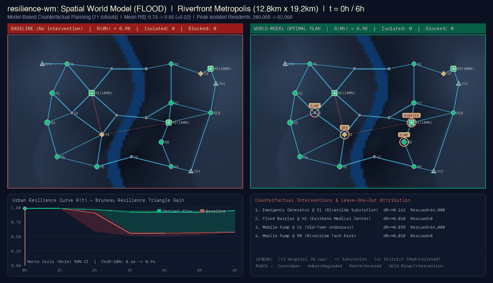
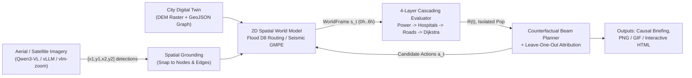
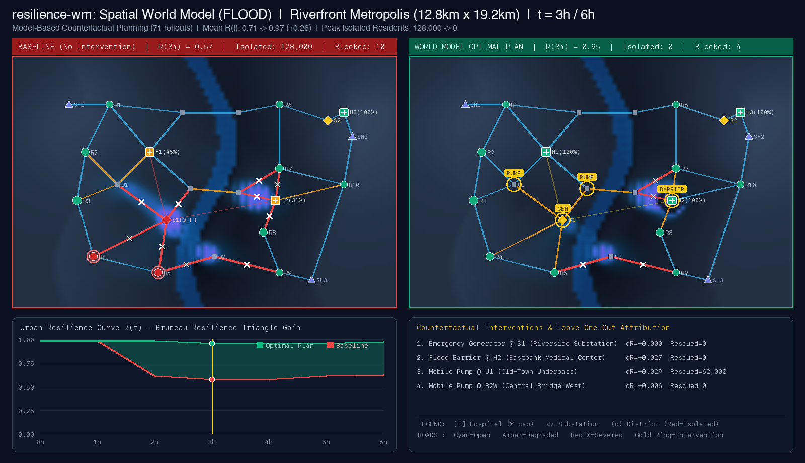
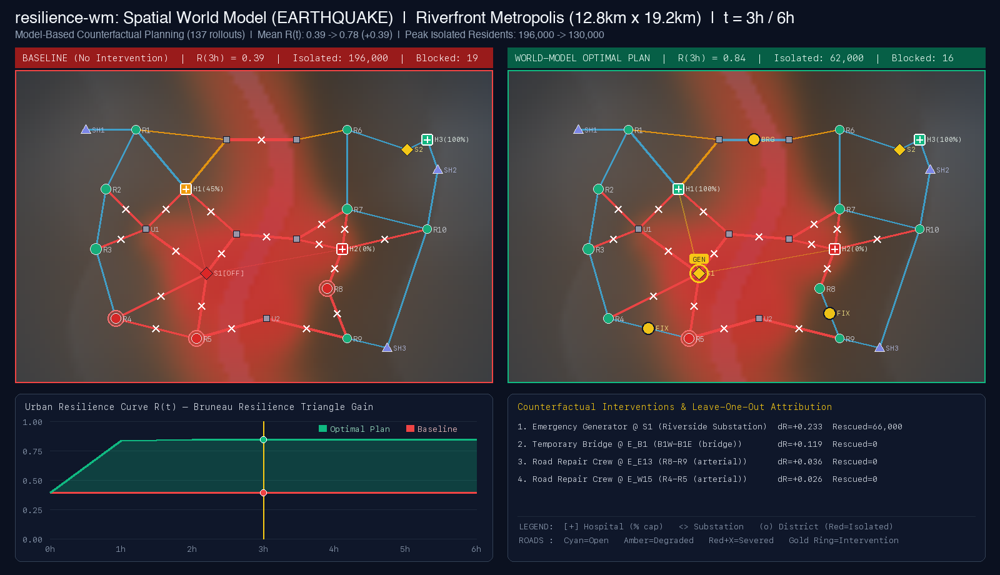

# resilience-wm

**Neuro-Symbolic Spatial World Model for Urban Resilience** — coupling 2D physical hazard simulation, 4-layer infrastructure cascading-failure reasoning, model-based counterfactual planning, and multimodal VLM disaster perception into a fast, zero-GPU Python package.

<p align="center">
  <a href="README_CN.md">中文文档</a> &bull;
  <a href="#live-world-model-rollout">Live Rollout</a> &bull;
  <a href="#architecture">Architecture</a> &bull;
  <a href="#measured-benchmarks">Benchmarks</a> &bull;
  <a href="#quick-start">Quick Start</a> &bull;
  <a href="#multimodal-vlm--geojson-integration">VLM &amp; GeoJSON</a>
</p>

<p align="center">
  
  
  
  
</p>

---

## Live World-Model Rollout

> **6-Hour Extreme Cloudburst Flood (`340 mm / 6h`) over Riverfront Metropolis (`12.8 km × 19.2 km`, 620,000 residents)** — comparing an unmitigated **Baseline** (left) against the **World-Model Optimal Counterfactual Plan** (right) across `0h -> 6h`.

<p align="center">
  
</p>

---

## Why `resilience-wm`?

Standard LLMs and VLMs can describe a disaster photo (*"the underpass is flooded"*), but **cannot reliably compute spatiotemporal physics or cross-layer cascading failures** (*"if Riverside Substation `S1` trips at `t=2h`, Central Hospital `H1` drops to 45% triage capacity, Eastbank Medical `H2` floods out, and 128,000 residents in `R4`/`R5` lose 25-minute ambulance reachability — where should 2 mobile pumps, 1 barrier, and 1 generator be deployed?"*).

`resilience-wm` solves this with a **Neuro-Symbolic Spatial World Model**:

1. **Multimodal Perception Grounding**: Ingests normalized `[0, 1000]` disaster bounding boxes from any OpenAI-compatible VLM (`vLLM` + `Qwen3-VL`, or [`vlm-zoom`](https://github.com/ca33-zx/vlm-zoom) on 4K aerial orthophotos) and snaps them onto city substations, bridges, tunnels, and basins.
2. **Dual-Hazard 2D Spatial Physics (`s_{t+1} = T_phys(s_t, a_t, ξ_t)`)**:
   - **Extreme Urban Flood**: Mass-conserving vectorized 2D D8 diffusive shallow-water routing over raster DEM, urban imperviousness, and storm drainage, modeling mobile pump dewatering and protective flood barriers.
   - **Near-Field Urban Earthquake**: GMPE ground-motion PGA attenuation + continuous Vs30 alluvium/bedrock site amplification + lognormal fragility curves + progressive road repair crew & temporary bridge recovery.
3. **4-Layer Cascading Failure & Spatial Graph Reasoning**: Propagates hazard states across **Power Grid -> Hospitals & Shelters -> Road/Bridge Network -> Population Accessibility** via multi-source Dijkstra (15-min/25-min ambulance reachability, largest connected component, and the **Bruneau Resilience Triangle** $R(t)$).
4. **Counterfactual World-Model Planning & Causal Attribution**: Runs simulator-in-the-loop beam search across dozens of forward rollouts under a resource budget, then runs **leave-one-out counterfactual ablations** on every selected intervention to quantify exact marginal resilience gain $\Delta R$ and residents rescued.
5. **Publication-Ready Visuals & Offline Sandbox**: Exports synchronized side-by-side comparison PNGs, animated `0h -> 6h` rollout GIFs, and compact (`< 150 KB`) zero-CDN interactive HTML5 sandboxes with time scrubbers and layer toggles.

---

## Architecture



---

## Measured Benchmarks

Evaluated deterministically on the built-in **Riverfront Metropolis** digital twin (`64 × 96` raster DEM @ 200 m/cell, 24 infrastructure nodes, 35 arterial/bridge/tunnel links, 620,000 residents) on CPU in **< 1.5 seconds per scenario**:

| Scenario | Rollouts Evaluated | Mean Resilience `R(t)` | Worst-Hour `R(t)` | Post-Shock Isolated Residents | Optimal Counterfactual Plan |
| --- | :---: | :---: | :---: | :---: | --- |
| **Extreme Cloudburst Flood** (`340 mm / 6h`) | 71 | `0.706 -> 0.967` (**`+0.261`**) | `0.570 -> 0.953` (`t=3h`) | `128,000 -> 0` (**128,000 rescued**) | `Generator@S1`, `Barrier@H2`, `Pump@U1`, `Pump@B2W` |
| **Near-Field Earthquake** (`Mw 6.8`, `10 km`) | 137 | `0.389 -> 0.776` (**`+0.387`**) | `0.389 -> 0.84` (`t=3h`) | `196,000 -> 130,000` (**66,000 rescued**; `62,000` by `t=3h`) | `Generator@S1`, `TempBridge@E_B1`, `Crew@E_E13`, `Crew@E_W15` |

### Scenario 1: Extreme Cloudburst Flood (`t = 3h` Peak Divergence)

<p align="center">
  
</p>

*Note on causal synergy*: Under the flood optimal plan, leave-one-out attribution highlights an authentic physical coupling — because `Pump@U1` and `Pump@B2W` jointly draw down the hydraulic gradient around `S1`, `Generator@S1` acts as synergistic redundancy (`dR=+0.000` individually while contributing to the combined `+0.261` resilience triangle gain and `128,000` residents rescued).

### Scenario 2: Near-Field Urban Earthquake (`Mw 6.8`, `t = 3h` Recovery)

<p align="center">
  
</p>

---

## Quick Start

### Install

```bash
git clone https://github.com/ca33-zx/resilience-wm.git
cd resilience-wm
pip install -e ".[dev]"
```

Pure Python with only `numpy`, `pillow`, and `httpx` — runs on macOS, Linux, and Windows CPU with zero CUDA/GDAL setup.

### CLI Usage

```bash
# Generate both Flood & Earthquake PNG banners, animated GIF, and interactive HTML sandboxes
resilience-wm demo --out-dir assets

# Run counterfactual planning on Flood or Earthquake and export JSON + interactive sandbox
resilience-wm plan --hazard flood --out-png flood.png --out-gif flood.gif --out-html flood.html
resilience-wm plan --hazard earthquake --json

# Open the zero-CDN interactive sandbox directly in your browser:
open assets/flood_sandbox.html
```

### Python API

```python
from resilience_wm import (
    CounterfactualPlanner,
    FloodForcing,
    ResourceBudget,
    build_riverfront_city,
    synthesize_causal_briefing,
)

city = build_riverfront_city()
planner = CounterfactualPlanner(
    city,
    hazard="flood",
    flood_forcing=FloodForcing(total_rain_mm=340.0, duration_hours=6.0),
)
comparison = planner.plan(
    budget=ResourceBudget(counts={"mobile_pump": 2, "mobile_generator": 1, "flood_barrier": 1}),
    beam_width=3,
)
print(synthesize_causal_briefing(city, comparison))
```

---

## Multimodal VLM & GeoJSON Integration

### 1. Live `vLLM` / `Qwen3-VL` Disaster Image Grounding

Pass an OpenAI-compatible VLM endpoint (`vLLM`, `SGLang`, `Ollama`, or OpenRouter) + an aerial/satellite disaster image. Detections in `[0, 1000]` normalized coordinates are automatically grounded onto the nearest substation, bridge, road, or underpass before counterfactual rollouts:

```python
from resilience_wm import SpatialReasoningAgent, build_riverfront_city

agent = SpatialReasoningAgent(
    build_riverfront_city(),
    base_url="http://localhost:8000/v1",
    model="Qwen/Qwen3-VL-4B-Instruct",
)
comparison, briefing = agent.run_mission(
    hazard="flood",
    image_path="aerial_cloudburst.png",
)
print(briefing)
```

For ultra-high-resolution (`4K`–`100MP+`) satellite or drone orthophotos, pair `resilience-wm` with [`ca33-zx/vlm-zoom`](https://github.com/ca33-zx/vlm-zoom) to zoom into flooded sub-regions before grounding detections into the world model.

### 2. Import Your Own City (`GeoJSON` + `.npy` DEM)

```python
from resilience_wm import CounterfactualPlanner, load_city_from_geojson

city = load_city_from_geojson("my_city.geojson", dem_npy_path="my_dem.npy")
comparison = CounterfactualPlanner(city, hazard="earthquake").plan()
```

Point features map to `UrbanNode` (`kind`: `residential` | `hospital` | `substation` | `shelter` | `underpass` | `hub`, plus `population` and `power_source`), and LineString features map to `UrbanEdge` (`u`, `v`, `kind`, `length_km`).

---

## Project Layout

```text
resilience-wm/
├── src/resilience_wm/
│   ├── city.py        # UrbanTwin raster + graph digital twin & GeoJSON/DEM loader
│   ├── physics.py     # 2D D8 overland flood routing & seismic GMPE fragility engine
│   ├── resilience.py  # 4-layer cascading failure propagation & multi-source Dijkstra
│   ├── planner.py     # Simulator-in-the-loop beam planner & leave-one-out attribution
│   ├── agent.py       # VLM [0,1000] spatial grounding & deterministic causal briefings
│   ├── viz.py         # GIS hillshade PNG banners, animated GIFs & offline HTML sandbox
│   └── cli.py         # `resilience-wm plan | demo` command-line entrypoint
├── examples/          # Flood counterfactual planning & VLM grounding runnable scripts
├── tests/             # 13 pytest tests covering physics, cascading failures, VLM & CLI
└── assets/            # Hero banners, animated rollout GIF & interactive HTML sandboxes
```

---

## Development & Verification

```bash
ruff check src tests examples
ruff format --check src tests examples
pytest -v
```

## License

Apache-2.0 &copy; 2026 [ca33-zx](https://github.com/ca33-zx)
