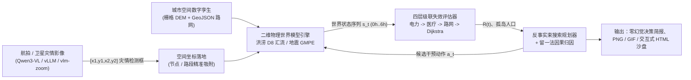

# resilience-wm

**面向城市韧性的神经符号空间世界模型（Neuro-Symbolic Spatial World Model for Urban Resilience）**——将二维灾害物理推演、四层基础设施跨层级联失效推理、基于世界模型的反事实干预规划与多模态 VLM 灾情视觉落地融为一体，纯 CPU 极速运行、零 GPU/GDAL 依赖。

<p align="center">
  <a href="README.md">English</a> &bull;
  <a href="#动态世界模型推演">动态推演</a> &bull;
  <a href="#系统架构">系统架构</a> &bull;
  <a href="#实测实验结果">实测结果</a> &bull;
  <a href="#快速上手">快速上手</a> &bull;
  <a href="#多模态-vlm-与自定义城市接入">VLM 与 GeoJSON</a>
</p>

<p align="center">
  
  
  
  
</p>

---

## 动态世界模型推演

> **极端短时强降雨洪涝场景（`340 mm / 6h`）· 沿江大都市数字孪生（`12.8 km × 19.2 km`，62 万常住人口）**：左侧为无干预**基线（Baseline）**，右侧为**世界模型反事实最优调度方案（Optimal Plan）**，同步展示 `0h -> 6h` 内涝演化、变电站跳闸、道路阻断、医院降容、孤岛社区与 Bruneau 韧性三角曲线 $R(t)$。

<p align="center">
  
</p>

---

## 核心解决什么问题？

通用大语言模型与多模态大模型可以“看图说话”（例如识别“某立交桥积水”），却**无法准确推演时空物理演化与跨层级联崩溃**（例如：*若沿江变电站 `S1` 在 `t=2h` 浸水跳闸，中心医院 `H1` 将掉电降容至 45%，东岸医院 `H2` 被淹停运，南岸 `R4`/`R5` 社区 12.8 万居民将陷入 25 分钟急救孤岛——有限的 2 台移动排涝泵、1 套防洪挡板和 1 台应急发电车到底该优先投放在哪？*）。

`resilience-wm` 采用**神经符号空间世界模型**闭环解决这一难题：

1. **多模态视觉感知落地（Spatial Grounding）**：直接对接任意 OpenAI 兼容 VLM 端点（`vLLM` + `Qwen3-VL`，或配合 [`vlm-zoom`](https://github.com/ca33-zx/vlm-zoom) 处理 4K 航拍正射影像），将 `[0, 1000]` 归一化灾情检测框精准吸附到城市孪生图的变电站、桥梁、隧道与低洼立交节点。
2. **双灾害二维物理世界模型（$s_{t+1} = T_{\text{phys}}(s_t, a_t, \xi_t)$）**：
   - **极端暴雨内涝（Flood）**：基于高程 DEM、不透水率与管网排水能力的守恒型二维 D8 扩散浅水汇流引擎，原生支持移动抽水泵强排与防洪挡板局部抬高干预。
   - **近场城市地震（Earthquake）**：GMPE 地震动 PGA 衰减场 + 连续 Vs30 河谷冲积层/基岩场地放大 + 对数正态易损性曲线 + 工程抢修队与应急浮桥的分时段恢复动力学。
3. **四层跨层级联失效与空间图推理**：沿着 **电力变电站 -> 医院与避难所 -> 道路与跨江桥梁网 -> 居民社区可达性** 逐层传播失效，采用多源 Dijkstra 计算 15/25 分钟医疗可达性、最大连通分量与 **Bruneau 韧性三角指标 $R(t)$**。
4. **反事实世界模型规划与留一法因果归因**：以世界模型为仿真器，在资源预算约束下执行束搜索（Beam Search）多步前向推演，并对最优组合中的每一项干预执行**留一法反事实消融（Leave-One-Out Attribution）**，量化每项部署的边际韧性增益 $\Delta R$ 与解救孤岛人口数。
5. **发表级可视化与离线交互沙盘**：一键生成高清双栏对比图（PNG）、`0h -> 6h` 动态演化图（GIF）以及 `< 150 KB` 零 CDN 单文件 HTML5 交互沙盘（支持时间轴拖拽、播放暂停与图层开关）。

---

## 系统架构



---

## 实测实验结果

在内置 **Riverfront Metropolis** 沿江大都市数字孪生（`64 × 96` 栅格 DEM @ 200 m/格，24 个基础设施节点，35 条主干道/桥梁/隧道，620,000 居民）上纯 CPU 确定性实测（单场景耗时 **< 1.5 秒**）：

| 灾害场景 | 推演次数 | 平均城市韧性 `R(t)` | 最严重时刻 `R(t)` | 灾后孤岛居民数 | 世界模型最优反事实部署方案 |
| --- | :---: | :---: | :---: | :---: | --- |
| **极端暴雨洪涝**（`340 mm / 6h`） | 71 次 | `0.706 -> 0.967`（**`+0.261`**） | `0.570 -> 0.953`（`t=3h`） | `128,000 -> 0`（**解救 12.8 万人**） | `发电车@S1`、`防洪挡板@H2`、`排涝泵@U1`、`排涝泵@B2W` |
| **近场城市地震**（`Mw 6.8`，震源 `10 km`） | 137 次 | `0.389 -> 0.776`（**`+0.387`**） | `0.389 -> 0.84`（`t=3h`） | `196,000 -> 130,000`（**峰值解救 6.6 万人**；`t=3h` 降至 `6.2 万人`） | `发电车@S1`、`应急浮桥@E_B1`、`抢修队@E_E13`、`抢修队@E_W15` |

### 场景一：极端暴雨洪涝（`t = 3h` 峰值对比）

<p align="center">
  
</p>

> **因果协同洞察**：在暴雨最优方案中，留一法归因自动揭示了真实的水文物理耦合效应——`排涝泵@U1` 与 `排涝泵@B2W` 联合拉低了 `S1` 周边水头，使 `发电车@S1` 形成协同冗余保护（单独移除时 `dR=+0.000`，而四项措施联合将整体平均韧性抬升 `+0.261` 并将 12.8 万孤岛人口全部清零）。

### 场景二：近场城市地震（`Mw 6.8`，`t = 3h` 恢复对比）

<p align="center">
  
</p>

---

## 快速上手

### 安装

```bash
git clone https://github.com/ca33-zx/resilience-wm.git
cd resilience-wm
pip install -e ".[dev]"
```

仅依赖 `numpy`、`pillow`、`httpx`，支持 macOS / Linux / Windows 纯 CPU 即装即用。

### 命令行工具（CLI）

```bash
# 一键生成洪涝与地震高清头图、动态演化 GIF 与交互式 HTML 沙盘
resilience-wm demo --out-dir assets

# 对指定灾害执行反事实世界模型规划，并导出 PNG / GIF / HTML 或 JSON
resilience-wm plan --hazard flood --out-png flood.png --out-gif flood.gif --out-html flood.html
resilience-wm plan --hazard earthquake --json

# 浏览器直接打开离线交互沙盘：
open assets/flood_sandbox.html
```

### Python API

```python
from resilience_wm import (
    CounterfactualPlanner,
    FloodForcing,
    ResourceBudget,
    build_riverfront_city,
    synthesize_causal_briefing,
)

city = build_riverfront_city()
planner = CounterfactualPlanner(
    city,
    hazard="flood",
    flood_forcing=FloodForcing(total_rain_mm=340.0, duration_hours=6.0),
)
comparison = planner.plan(
    budget=ResourceBudget(counts={"mobile_pump": 2, "mobile_generator": 1, "flood_barrier": 1}),
    beam_width=3,
)
print(synthesize_causal_briefing(city, comparison))
```

---

## 多模态 VLM 与自定义城市接入

### 1. 对接 `vLLM` / `Qwen3-VL` 航拍灾情视觉识别

```python
from resilience_wm import SpatialReasoningAgent, build_riverfront_city

agent = SpatialReasoningAgent(
    build_riverfront_city(),
    base_url="http://localhost:8000/v1",
    model="Qwen/Qwen3-VL-4B-Instruct",
)
comparison, briefing = agent.run_mission(
    hazard="flood",
    image_path="aerial_cloudburst.png",
)
print(briefing)
```

针对 `4K`–`100MP+` 超高分辨率卫星/无人机正射影像，可搭配 [`ca33-zx/vlm-zoom`](https://github.com/ca33-zx/vlm-zoom) 先做局部高倍变焦检查，再将检测框注入 `resilience-wm` 世界模型推演。

### 2. 导入自定义真实城市（`GeoJSON` + `.npy` 高程 DEM）

```python
from resilience_wm import CounterfactualPlanner, load_city_from_geojson

city = load_city_from_geojson("my_city.geojson", dem_npy_path="my_dem.npy")
comparison = CounterfactualPlanner(city, hazard="earthquake").plan()
```

---

## 验证测试

```bash
ruff check src tests examples
ruff format --check src tests examples
pytest -v
```

## 开源协议

Apache-2.0 &copy; 2026 [ca33-zx](https://github.com/ca33-zx)
