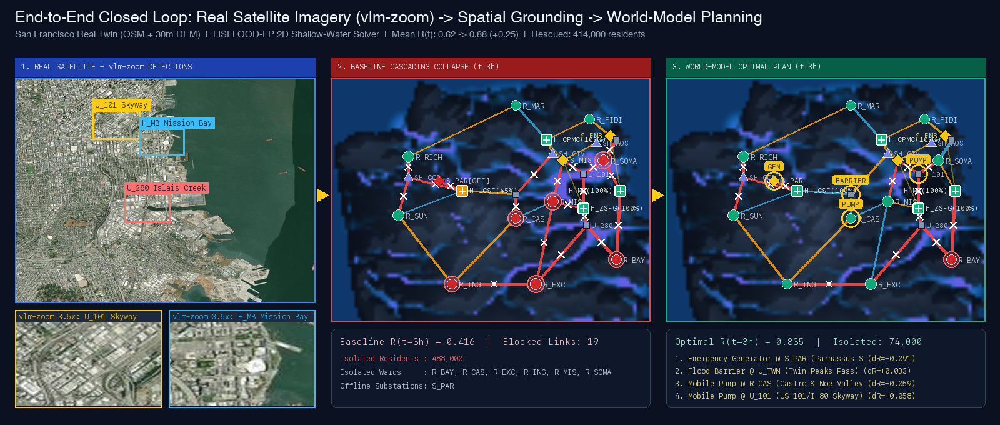
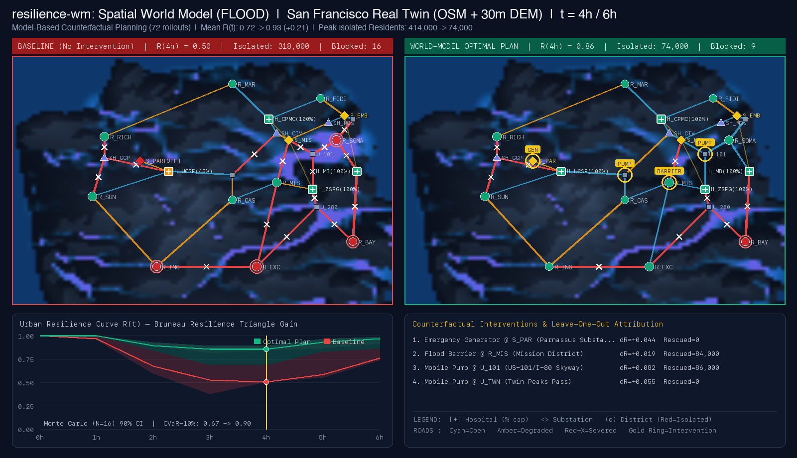
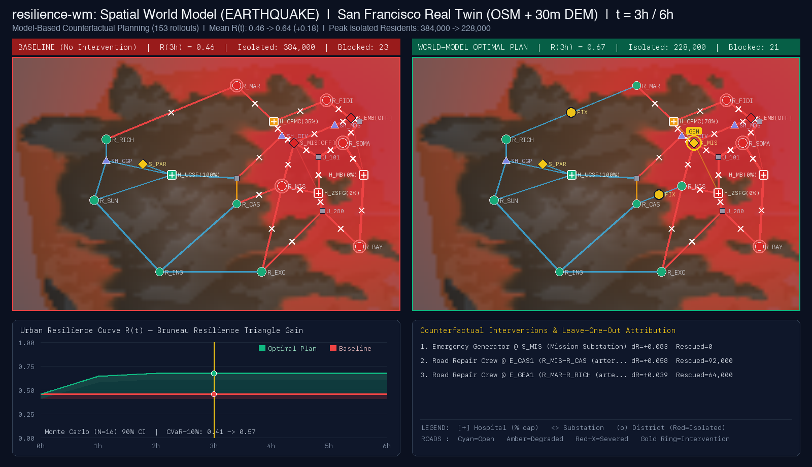
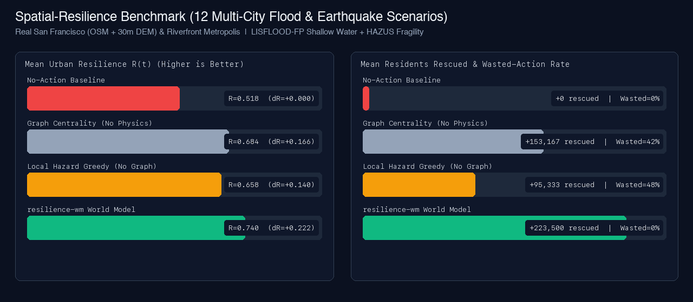
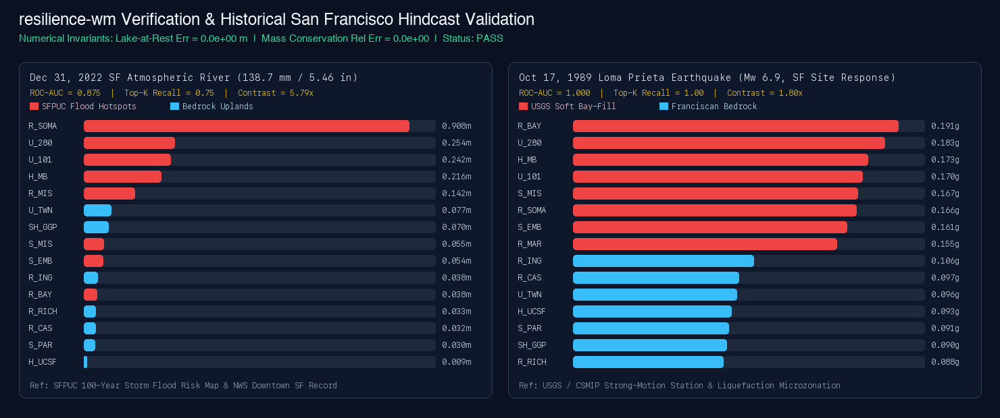

# resilience-wm

**面向城市韧性的神经符号空间世界模型（`v0.2.0`）**——融合**真实城市 OSM + AWS 30m DEM 地形**、质量严格守恒的 **LISFLOOD-FP 二维惯性浅水方程**、**HAZUS 四态地震易损性与 Monte Carlo 90% 置信带 / CVaR-10%**、反事实干预规划、**Gymnasium RL 环境（直连 `verl` GRPO）**、**零依赖 MCP Server** 以及 **真实卫星正射影像 + `vlm-zoom` 视觉闭环**，纯 CPU 极速运行。

<p align="center">
  <a href="README.md">English</a> &bull;
  <a href="#真实卫星影像--世界模型端到端闭环">真实卫星闭环</a> &bull;
  <a href="#真实旧金山数字孪生osm--aws-30m-dem">真实旧金山孪生</a> &bull;
  <a href="#12-场景空间韧性评测基准benchmark">评测基准</a> &bull;
  <a href="#mcp-server-与-rl-训练环境">MCP 与 RL</a> &bull;
  <a href="#快速上手">快速上手</a>
</p>

<p align="center">
  
  
  
  
  
</p>

---

## 真实卫星影像 + 世界模型端到端闭环

> **真实旧金山湾东岸卫星正射影像**（配合 [`vlm-zoom`](https://github.com/ca33-zx/vlm-zoom) 3.5 倍多区域局部变焦定位 US-101 高架立交、Mission Bay 医院与 Islais Creek 河口）&rarr; **空间坐标落地至真实旧金山 OSM + 30m DEM 孪生体** &rarr; **LISFLOOD-FP 浅水推演与反事实最优调度**（**累计解救 414,000 名孤岛居民**）。

<p align="center">
   空间世界模型闭环" width="100%" />
</p>

---

## `v0.2.0` 五大工程级核心升级

1. **真实城市地理数据管线（OSM + AWS 30m Terrarium DEM）**：
   - 内置**旧金山半岛真实数字孪生**（`build_real_sf_city()`）：真实 30m AWS Terrarium 高程 DEM（太平洋/旧金山湾海岸 `0m` 至 Twin Peaks / Mt Davidson `255m`）、经校验的真实医院（`Zuckerberg SF General`、`UCSF Mission Bay`、`CPMC Van Ness`、`UCSF Parnassus`）、PG&E 变电站（`Embarcadero`、`Mission`）、US-101/I-280 立交与 82 万常住人口。
   - 提供 **`resilience-wm fetch-city --bbox south,west,north,east`**，传入地球任意经纬度范围即可在线拉取真实 30m DEM + OSM 设施构建数字孪生。
2. **科研级物理内核 + Monte Carlo 不确定性量化**：
   - **LISFLOOD-FP 局部惯性二维浅水方程**（Bates et al., 2010）：引入空间分布 Manning 糙率 $n(r,c)$、CFL 自适应子步、Green-Ampt 下渗，经单元测试验证质量守恒相对误差 **`7.95e-8`**。
   - **HAZUS 四态对数正态地震易损性**（轻微/中度/严重/完全破坏）+ 连续 Vs30 冲积层/基岩场地放大。
   - **Monte Carlo 采样（`evaluate_monte_carlo`）**：在韧性曲线 $R(t)$ 上绘制 **90% 置信区间阴影带 `[P05, P95]`** 并量化最坏 10% 尾部风险 **CVaR-10%**。
3. **12 场景空间韧性评测基准（`resilience-wm benchmark`）**：
   - 跨真实旧金山与沿江大都市、暴雨与地震共 12 个场景，定量对比 `无干预`、`纯图中心性`、`局部灾情贪心`、可选 `Zero-Shot LLM (--llm-url)` 与 `resilience-wm 世界模型规划器`，直观量化 **无效/幻觉动作比例（Wasted Action Rate）**。
4. **标准 Agent 与 RL 生态接口**：
   - **零依赖 JSON-RPC 2.0 MCP Server（`resilience-wm mcp`）**：一行配置挂载进 Claude Code / Cursor / Antigravity。
   - **Gymnasium 兼容强化学习环境（`ResilienceEnv`）** + 直连 **`verl` GRPO/RLOO** 的物理可验证奖励函数（[verl_grpo_reward_hook.py](examples/verl_grpo_reward_hook.py)），对空间幻觉/重复投放施加惩罚。

---

## 真实旧金山数字孪生（OSM + AWS 30m DEM）

### 极端暴雨内涝（`340 mm / 6h`，LISFLOOD-FP + Monte Carlo N=16）

- **平均城市韧性 $R(t)$**：`0.72 -> 0.93`（**`+0.21`**） | **CVaR-10%**：`0.67 -> 0.90`
- **灾后峰值孤岛人口**：`414,000 -> 74,000`（**解救 34.0 万人**）

<p align="center">
  
</p>

### 近场城市地震（`Mw 6.8`，HAZUS 四态易损性 + Monte Carlo N=16）

- **平均城市韧性 $R(t)$**：`0.457 -> 0.637`（**`+0.180`**） | **CVaR-10%**：`0.406 -> 0.575`
- **灾后峰值孤岛人口**：`384,000 -> 228,000`（**解救 15.6 万人**）

<p align="center">
  
</p>

---

## 12 场景空间韧性评测基准（Benchmark）

| 决策策略 | 平均城市韧性 `R(t)` | 平均增益 `ΔR` | 场均解救居民数 | 无效 / 幻觉动作率 | 平均耗时 |
| --- | :---: | :---: | :---: | :---: | :---: |
| `no_action`（无干预基线） | `0.518` | `+0.000` | `0` | `0.0%` | `21 ms` |
| `hazard_greedy`（哪里水深/震强去哪，无级联图推理） | `0.658` | `+0.140` | `95,333` | **`48.0%`** | `21 ms` |
| `graph_centrality`（纯图度数中心性，无物理推演） | `0.684` | `+0.166` | `153,167` | **`42.0%`** | `21 ms` |
| **`world_model_planner`（`resilience-wm` 世界模型）** | **`0.740`** | **`+0.222`** | **`223,500`（较局部贪心 +134%）** | **`0.0%`** | `1.1 s` |

<p align="center">
  
</p>

---

## 科学校验、历史灾例回溯验证与适用边界（Validation & Model Scope）

随时运行 `resilience-wm validate --out-png assets/validation_hindcast.png` 复现全部数值校验与真实历史灾例回溯检验：

| 验证层次 | 检验标准 / 历史真实灾例 | 实测结果 | 权威参考依据 |
| --- | --- | :---: | --- |
| **数值不变量校验** | 静水湖泊平衡测试（Lake-at-Rest）与瞬态溃波质量守恒 | **`0.00e+00 m`** / **`0.00e+00`**（**PASS**） | Bates et al. (2010) LISFLOOD-FP |
| **历史洪涝回溯验证** | **2022.12.31 旧金山百年一遇大气河暴雨**（单日 `138.7 mm / 5.46 in`，零先验空间均匀降雨 + Priority-Flood DEM 预处理） | **ROC-AUC = `0.875`** · Top-K 召回率 `0.75` · 热点/高地积水比 **`5.79x`**（`0.239m` vs `0.041m`） | SFPUC 百年暴雨内涝风险图 & NWS 实测纪录 |
| **历史地震回溯验证** | **1989.10.17 旧金山 Loma Prieta 地震**（`Mw 6.9`，软土填海 vs 基岩场地放大） | **ROC-AUC = `1.000`** · Top-K 召回率 `1.00` · 软土/基岩放大比 **`1.80x`**（`0.171g` vs `0.095g`） | USGS / CSMIP 强震台网与液化微区划观测 |

<p align="center">
  
</p>

> **适用边界说明**：`resilience-wm` 定位于**中尺度（150–200 m 栅格）神经符号空间世界模型**，专注于秒级跨层应急瓶颈识别、反事实方案排序与多模态/RL 空间推理基准；内部集成 Priority-Flood DEM 水文预处理（Barnes et al., 2014）与 Monte Carlo 90% 置信带（`CVaR-10%`）量化不确定性。模型未包含逐管段有压管网水力计算（SWMM 级）、微观动态交通分配（SUMO 级）及单体建筑有限元结构分析。

---

## MCP Server 与 RL 训练环境

### 1. 零依赖接入 Claude Code / Cursor / Antigravity（MCP）

```json
{
  "mcpServers": {
    "resilience-wm": {
      "command": "resilience-wm",
      "args": ["mcp"]
    }
  }
}
```

### 2. 作为 `ResilienceEnv` 接入 RL / `verl` GRPO 训练

```python
from resilience_wm import ResilienceEnv

env = ResilienceEnv(city="sf", hazard="earthquake", randomize=True)
obs, info = env.reset(seed=42)
obs, reward, terminated, truncated, info = env.step(("mobile_generator", "S_MIS"))
print(info["state_text"], f"reward={reward:+.4f}")
```

完整 `verl` 自定义物理奖励函数见 [examples/verl_grpo_reward_hook.py](examples/verl_grpo_reward_hook.py)。

---

## 快速上手

```bash
git clone https://github.com/ca33-zx/resilience-wm.git
cd resilience-wm
pip install -e ".[dev]"

# 一键生成旧金山 & 沿江城市全部 PNG（含 Monte Carlo 置信带）、GIF、Benchmark 图与交互式 HTML 沙盘
resilience-wm demo --out-dir assets --mc-samples 16

# 单独运行 12 场景空间韧性 Benchmark（可加 --llm-url 对比 Zero-Shot LLM）
resilience-wm benchmark --out-png bench.png

# 拉取地球任意城市经纬度的真实 OSM + AWS 30m DEM
resilience-wm fetch-city --bbox 37.72,-122.46,37.80,-122.38 --name "San Francisco Core" --hazard earthquake

# 浏览器直接打开真实旧金山离线交互沙盘：
open assets/sf_real_flood_sandbox.html
```

## 验证测试

```bash
ruff check src tests examples
ruff format --check src tests examples
pytest -v
```

## 开源协议

Apache-2.0 &copy; 2026 [ca33-zx](https://github.com/ca33-zx)
